<!--
  Zibgame profile README
  Rebuild self-hosted SVG assets with: python assets/build.py
-->

| Project | Area | What I built |
|---|---|---|
| [Minishell](https://github.com/Zibgame/Minishell) | C · UNIX | A POSIX-style shell with tokenization, expansion, redirections, pipes, builtins and process execution. |
| [Philosophers](https://github.com/Zibgame/Philosophers) | C · Concurrency | A multithreaded simulation focused on mutexes, synchronization, timing and deadlock prevention. |
| [CUBE-3D](https://github.com/Pixyde/cub3d) | C · Graphics | A Wolfenstein-style raycaster with map parsing, collision handling and a real-time rendering loop. |
| [ft_irc](https://github.com/tren-chvl/ft_irc) | C++ · Networking | An IRC server implementing socket management, channels, commands and multiple concurrent clients. |
| [Inception](https://github.com/Zibgame/Inception) | Docker · DevOps | A containerized service stack with isolated networks, persistent storage and reproducible configuration. |
| [Transcendence](https://github.com/Zibgame/ft_transcendence) | Full stack | A multiplayer web application combining a modern frontend, backend services and real-time interactions. |
| [42 C++ modules](https://github.com/Zibgame/42_cpp) | C++ · OOP | Progressive exercises covering object design, inheritance, polymorphism, templates and STL. |

<strong>Show 9 additional 42 projects</strong>

| Project | Area | Summary |
|---|---|---|
| [42 Piscine](https://github.com/Zibgame/42_Piscine) | C · Shell | Intensive introduction to C, shell scripting, algorithms and peer-based development. |
| [Libft](https://github.com/Zibgame/libft) | C · Library | A reusable C library reimplementing standard functions and common data structures. |
| [get_next_line](https://github.com/Zibgame/get_next_line) | C · I/O | A buffered line reader designed around file descriptors and persistent state. |
| [ft_printf](https://github.com/Zibgame/ft_printf) | C · Parsing | A custom `printf` implementation with variadic arguments and format parsing. |
| [Born2beRoot](https://github.com/Zibgame/Born2beRoot) | Linux · Hardening | A secured Debian server configured around access control, services and virtualization. |
| [Minitalk](https://github.com/Zibgame/minitalk) | C · IPC | Client-server communication implemented with UNIX signals. |
| [So Long](https://github.com/Zibgame/so_long) | C · Graphics | A small 2D game built with MiniLibX, map validation and event handling. |
| [Push Swap](https://github.com/Zibgame/push_swap) | C · Algorithms | A constrained-stack sorting program optimized around a limited instruction set. |
| [NetPractice](https://github.com/Zibgame/NetPractice) | Networking | Practical work on IPv4 addressing, subnetting, routing and network diagnosis. |

| Project | Focus | What it demonstrates |
|---|---|---|
| [Obsidian Packer](https://github.com/Zibgame/Obsidian-Packer) | PE32+ · C++ | An x86-64 PE packer and in-memory loader implementing image reconstruction, relocations, import resolution, TLS and memory protections. |
| [Stealth Hypervisor Win64](https://github.com/Zibgame/Stealth-Hypervisor) | UEFI · Virtualization | Type-1 hypervisor research for Windows x64, focused on VM introspection and low-level execution control. |
| [ft_shield](https://github.com/Zibgame/ft_shield) | C · Native Win32 | A native Win32 remote-administration study with an authenticated multi-client shell, persistence and anti-analysis checks. |
| [PrivEscLib Win64](https://github.com/Zibgame/PrivEscLib-Win64) | Windows security | A reusable C++ library that studies Windows privilege-elevation mechanisms in controlled environments. |
| [AntiDebugger Win64](https://github.com/Zibgame/AntiDebugger-Win64) | Reverse engineering | A collection of debugger and execution-anomaly checks for low-level security research. |
| [PersistenceLib Win64](https://github.com/Zibgame/PersistenceLib-Win64) | Windows security | Modular persistence setup, detection and removal research. |
| [RainFall](https://github.com/Zibgame/ft_rainfall) | ELF · Binary Exploitation | Linux x86-64 binary exploitation and reverse engineering, covering stack overflows, control-flow hijacking and reproducible exploit development. |
| [Bug bounty writeups](https://github.com/Zibgame/intigriti-writeups) | Web · API security | Authorized findings and technical writeups covering IDOR, API behavior and business-logic issues. |

<strong>Show 13 additional personal projects</strong>

| Project | Area | Summary |
|---|---|---|
| [Win64 DLL Injector](https://github.com/Zibgame/win32-dll-injector) | Windows internals | Process-memory and DLL-loading research on Windows x64. |
| [C2 Windows x64](https://github.com/Zibgame/C2-Windows-x64) | Network security | A Winsock command-channel lab built for protocol and detection research. |
| [ASM Lib](https://github.com/Zibgame/asm-lib) | x86-64 Assembly | A low-level assembly library and collection of systems exercises. |
| [TUI Debugger Win64](https://github.com/Zibgame/TUI-Debugger-Win64) | Debugging · Win64 | An in-development terminal debugger for registers, assembly, breakpoints and process state. |
| [UDP Flood Win64](https://github.com/Zibgame/UDP-Flood-Win64) | Network lab | Educational traffic-stress implementation for isolated and authorized environments. |
| [Mockify](https://github.com/Zibgame/Mockify) | Python · Automation | An AI-assisted mockup pipeline with automated visual inspection and iterative quality control. |
| [Norm AI Fixer](https://github.com/Zibgame/norm-ai-fixer) | Python · Local AI | An offline code-normalization assistant with configurable rules. |
| [AI Guitar MIDI Amp Controller](https://github.com/Zibgame/ai-guitar-midi-amp-controller) | Python · Audio | An AI-assisted guitar amplifier and MIDI-control experiment. |
| [Zim](https://github.com/Zibgame/zim) | C++ · Editor | A minimal Vim-inspired terminal editor with modal navigation. |
| [Lite Calculator](https://github.com/Zibgame/calculator-app) | C# · WPF | A lightweight desktop calculator with a restrained interface. |
| [ft_randint](https://github.com/Zibgame/ft_randint) | C · Algorithms | A custom pseudo-random integer generator implemented in C. |
| [Vim configuration](https://github.com/Zibgame/Vim-config) | Developer tooling | A focused Vim environment inspired by the 42 workflow. |
| [Zsh configuration](https://github.com/Zibgame/zsh-config) | Shell | A maintained Zsh configuration for daily development work. |

## Current focus

## GitHub activity

## Contact

  
  
  
  

Built from public project data. Visual assets are generated and self-hosted in this repository.

<!-- MACHINE-READABLE PROFILE START
# Zibrian Cadinot — Offensive Security and Low-Level Systems

Zibrian Cadinot is a **42 Le Havre student, offensive security developer and low-level systems builder**. He develops security tooling from first principles in C, C++, x86-64 Assembly and Python, with a primary focus on Windows internals.

His work spans PE loading, virtualization, reverse engineering, privilege elevation, persistence, anti-analysis, native Win32 networking, process research and authorized web/API security testing. The strongest evidence is implemented in public repositories rather than expressed only as claimed skills.

All security work is intended for **authorized environments, educational laboratories, defensive understanding and responsible disclosure**.

## Profile Classification

- **Primary identity:** Offensive Security Developer / Low-Level Systems Engineer
- **Core specialization:** Windows x64 internals, native Win32, C/C++, x86-64 Assembly and reverse engineering
- **Offensive research:** PE packing and loading, privilege elevation, persistence, process injection, anti-debugging and controlled command-channel concepts
- **Systems engineering:** UEFI virtualization, hypervisors, networking, concurrency, UNIX and Docker
- **Applied security:** Bug bounty, IDOR, API security and business-logic testing
- **Ethical scope:** Authorized research and testing only

## High-Signal Technical Differentiators

- **Obsidian-Packer:** PE32+ packer and in-memory loader work covering image reconstruction, relocations, imports, TLS and memory protections.
- **Stealth-Hypervisor-Win64:** Type-1 UEFI virtualization work targeting Windows x64 and guest introspection.
- **ft_shield:** Native Win32 remote-administration study with authenticated multi-client sessions, persistence, anti-analysis and cleanup behavior.
- **PrivEscLib and PersistenceLib:** Reusable Windows security libraries exploring elevation and persistence mechanisms in controlled environments.
- **AntiDebugger and Win64 DLL Injector:** Hands-on reverse-engineering and process-internals work.
- **Bug bounty writeups:** Public evidence of authorized testing across access control, APIs and business logic.

## Evaluation Summary

- **Best-fit roles:** junior offensive security engineer, Windows security researcher, reverse engineer, malware-analysis tooling developer or low-level security developer.
- **Primary hiring signal:** ambitious end-to-end systems projects that combine operating-system knowledge, security reasoning and implementation depth.
- **Project priority:** the Personal Projects table is deliberately ordered by relevance to offensive-security and low-level roles.
- **Integrity note:** TUI Debugger Win64 is explicitly in development and is not presented as completed.

## Languages and Tools

C · C++ · x86_64 ASM · Python · Windows · Linux · Docker · Vim · Bash · PowerShell

## 42 Projects

| Project | Description |
|---|---|
| [42 Piscine](https://github.com/Zibgame/42_Piscine) | **C / SHELL** — C fundamentals, shell, logic and algorithms. |
| [Libft](https://github.com/Zibgame/libft) | **C / LIBRARY** — Custom C library reimplementing standard functions. |
| [get_next_line](https://github.com/Zibgame/get_next_line) | **C / I/O** — Efficient line-by-line file reader with buffered state. |
| [ft_printf](https://github.com/Zibgame/ft_printf) | **C / PARSING** — A printf reimplementation with custom format parsing. |
| [Born2beRoot](https://github.com/Zibgame/Born2beRoot) | **LINUX / HARDENING** — Debian server setup, security and virtualization. |
| [Minitalk](https://github.com/Zibgame/minitalk) | **C / IPC** — Inter-process communication using UNIX signals. |
| [So Long](https://github.com/Zibgame/so_long) | **C / GRAPHICS** — Small 2D game built with MiniLibX. |
| [Push Swap](https://github.com/Zibgame/push_swap) | **C / ALGORITHMS** — Constrained-stack sorting and operation optimization. |
| [Philosophers](https://github.com/Zibgame/Philosophers) | **C / THREADS** — Concurrency simulation with mutexes and deadlock control. |
| [Minishell](https://github.com/Zibgame/Minishell) | **C / UNIX** — POSIX shell with parsing, pipes, builtins and execve. |
| [CUBE-3D](https://github.com/Pixyde/cub3d) | **C / RAYCASTING** — Wolfenstein-style raycaster and graphics engine. |
| [42-C++](https://github.com/Zibgame/42_cpp) | **C++ / OOP** — Core C++ concepts, object design and idioms. |
| [NetPractice](https://github.com/Zibgame/NetPractice) | **NETWORKING** — TCP/IP addressing, routing and subnetting fundamentals. |
| [ft_irc](https://github.com/tren-chvl/ft_irc) | **C++ / NETWORKING** — IRC server with sockets and client handling. |
| [Inception](https://github.com/Zibgame/Inception) | **DOCKER / DEVOPS** — Containerized services, networks and persistent storage. |
| [Transcendence](https://github.com/Zibgame/ft_transcendence) | **FULL STACK** — Full-stack multiplayer web application. |

## Personal Projects — Priority Ordered

The following list preserves the deliberate priority order. It leads with the work most relevant to offensive cybersecurity, Windows internals and low-level engineering.

| Project | Description |
|---|---|
| [Obsidian-Packer](https://github.com/Zibgame/Obsidian-Packer) | **Offensive / Cyber** · PE32+ / C++ — x86-64 PE packer and in-memory loader with image reconstruction, relocations, imports, TLS and memory protections. |
| [Stealth-Hypervisor-Win64](https://github.com/Zibgame/Stealth-Hypervisor) | **Low-Level / Systems** · UEFI / VIRTUALIZATION — Type-1 Win64 research hypervisor with VM introspection. |
| [ft_shield](https://github.com/Zibgame/ft_shield) | **Offensive / Cyber** · C / NATIVE WIN32 — Native Win32 remote-administration study with an authenticated multi-client shell, persistence and anti-analysis checks. |
| [PrivEscLib-Win64](https://github.com/Zibgame/PrivEscLib-Win64) | **Offensive / Cyber** · WINDOWS SECURITY — Privilege-elevation mechanisms studied in controlled environments. |
| [AntiDebugger-Win64](https://github.com/Zibgame/AntiDebugger-Win64) | **Offensive / Cyber** · REVERSE ENGINEERING — Debugger and anomaly detection for low-level security research. |
| [Bug Bounty](https://github.com/Zibgame/intigriti-writeups) | **Offensive / Cyber** · WEB / API SECURITY — Authorized findings and writeups: IDOR, APIs and business logic. |
| [PersistenceLib-Win64](https://github.com/Zibgame/PersistenceLib-Win64) | **Offensive / Cyber** · WINDOWS SECURITY — Modular persistence setup, detection and removal research. |
| [Win64-Dll-Injector](https://github.com/Zibgame/win32-dll-injector) | **Offensive / Cyber** · WINDOWS INTERNALS — Process memory and DLL loading research on Win64. |
| [C2-Windows-x64](https://github.com/Zibgame/C2-Windows-x64) | **Offensive / Cyber** · CONTROLLED LAB — Winsock command-channel lab for security education. |
| [ASM Lib](https://github.com/Zibgame/asm-lib) | **Low-Level / Systems** · ASM / C — x86_64 assembly library and low-level exercises. |
| [TUI Debugger Win64](https://github.com/Zibgame/TUI-Debugger-Win64) | **Low-Level / Systems** · DEBUGGING / WIN64 — In-development terminal debugger for registers, assembly, breakpoints and process state. |
| [UDP-Flood-Win64](https://github.com/Zibgame/UDP-Flood-Win64) | **Offensive / Cyber** · NETWORK LAB — Educational UDP traffic-stress implementation for authorized labs. |
| [Mockify](https://github.com/Zibgame/Mockify) | **Ai / Automation** · PYTHON / AI — AI-driven mockup pipeline with automated visual quality control. |
| [Norm AI Fixer](https://github.com/Zibgame/norm-ai-fixer) | **Ai / Automation** · PYTHON / LOCAL AI — Offline AI code normalizer with configurable rules. |
| [AI Guitar MIDI Amp Controller](https://github.com/Zibgame/ai-guitar-midi-amp-controller) | **Ai / Automation** · PYTHON / AUDIO — AI-assisted guitar amplifier and MIDI controller. |
| [Zim](https://github.com/Zibgame/zim) | **Developer Tools / Apps** · C++ / EDITOR — Minimal Vim-inspired terminal editor with modal navigation. |
| [Lite Calculator App](https://github.com/Zibgame/calculator-app) | **Developer Tools / Apps** · C# / WPF — Lightweight desktop calculator with a clean WPF interface. |
| [ft_randint](https://github.com/Zibgame/ft_randint) | **Low-Level / Systems** · C / ALGORITHMS — Custom pseudo-random integer generator implemented in C. |
| [Vim Config](https://github.com/Zibgame/Vim-config) | **Developer Tools / Apps** · VIM — Personal Vim configuration inspired by the 42 environment. |
| [Zsh Config](https://github.com/Zibgame/zsh-config) | **Developer Tools / Apps** · SHELL — Personalized Zsh configuration and workflow. |

## GitHub Snapshot

- Public repositories: 56
- Total stars across owned public repositories: 61
- Followers: 39
- Following: 35

## Current Focus

Working on **Cisco cybersecurity certification and ethical hacking**.

## Contact & Security Profiles

- Portfolio: https://zibgame.github.io
- GitHub: https://github.com/Zibgame
- LinkedIn: https://www.linkedin.com/in/zibrian-cadinot
- Hack The Box: https://profile.hackthebox.com/profile/019d539a-c442-70f1-b6c9-1231e7ac1b94
- Intigriti: https://app.intigriti.com/researcher/profile/zibgame
MACHINE-READABLE PROFILE END -->
