<!--
  Zibgame profile README
  Rebuild self-hosted SVG assets with: python assets/build.py
-->

| Project | Area | What I built |
|---|---|---|
| [Minishell](https://github.com/Zibgame/Minishell) | C · UNIX | A POSIX-style shell with tokenization, expansion, redirections, pipes, builtins and process execution. |
| [Philosophers](https://github.com/Zibgame/Philosophers) | C · Concurrency | A multithreaded simulation focused on mutexes, synchronization, timing and deadlock prevention. |
| [CUBE-3D](https://github.com/Pixyde/cub3d) | C · Graphics | A Wolfenstein-style raycaster with map parsing, collision handling and a real-time rendering loop. |
| [ft_irc](https://github.com/tren-chvl/ft_irc) | C++ · Networking | An IRC server implementing socket management, channels, commands and multiple concurrent clients. |
| [Inception](https://github.com/Zibgame/Inception) | Docker · DevOps | A containerized service stack with isolated networks, persistent storage and reproducible configuration. |
| [Transcendence](https://github.com/Zibgame/ft_transcendence) | Full stack | A multiplayer web application combining a modern frontend, backend services and real-time interactions. |

<strong>Show 10 additional 42 projects</strong>

| Project | Area | Summary |
|---|---|---|
| [42 Piscine](https://github.com/Zibgame/42_Piscine) | C · Shell | Intensive introduction to C, shell scripting, algorithms and peer-based development. |
| [Libft](https://github.com/Zibgame/libft) | C · Library | A reusable C library reimplementing standard functions and common data structures. |
| [get_next_line](https://github.com/Zibgame/get_next_line) | C · I/O | A buffered line reader designed around file descriptors and persistent state. |
| [ft_printf](https://github.com/Zibgame/ft_printf) | C · Parsing | A custom `printf` implementation with variadic arguments and format parsing. |
| [Born2beRoot](https://github.com/Zibgame/Born2beRoot) | Linux · Hardening | A secured Debian server configured around access control, services and virtualization. |
| [Minitalk](https://github.com/Zibgame/minitalk) | C · IPC | Client-server communication implemented with UNIX signals. |
| [So Long](https://github.com/Zibgame/so_long) | C · Graphics | A small 2D game built with MiniLibX, map validation and event handling. |
| [Push Swap](https://github.com/Zibgame/push_swap) | C · Algorithms | A constrained-stack sorting program optimized around a limited instruction set. |
| [42 C++ modules](https://github.com/Zibgame/42_cpp) | C++ · OOP | Progressive exercises covering object design, inheritance, polymorphism, templates and STL. |
| [NetPractice](https://github.com/Zibgame/NetPractice) | Networking | Practical work on IPv4 addressing, subnetting, routing and network diagnosis. |

| Project | Focus | What it demonstrates |
|---|---|---|
| [Obsidian Packer](https://github.com/Zibgame/Obsidian-Packer) | PE32+ · C++ | An x86-64 PE packer and in-memory loader implementing image reconstruction, relocations, import resolution, TLS and memory protections. |
| [Stealth Hypervisor Win64](https://github.com/Zibgame/Stealth-Hypervisor) | UEFI · Virtualization | Type-1 hypervisor research for Windows x64, focused on VM introspection and low-level execution control. |
| [ft_shield](https://github.com/Zibgame/ft_shield) | C · Native Win32 | A native Win32 remote-administration study with an authenticated multi-client shell, persistence and anti-analysis checks. |
| [PrivEscLib Win64](https://github.com/Zibgame/PrivEscLib-Win64) | Windows security | A reusable C++ library that studies Windows privilege-elevation mechanisms in controlled environments. |
| [AntiDebugger Win64](https://github.com/Zibgame/AntiDebugger-Win64) | Reverse engineering | A collection of debugger and execution-anomaly checks for low-level security research. |
| [Bug bounty writeups](https://github.com/Zibgame/intigriti-writeups) | Web · API security | Authorized findings and technical writeups covering IDOR, API behavior and business-logic issues. |

<strong>Show 14 additional personal projects</strong>

| Project | Area | Summary |
|---|---|---|
| [PersistenceLib Win64](https://github.com/Zibgame/PersistenceLib-Win64) | Windows security | Modular persistence setup, detection and removal research. |
| [Win64 DLL Injector](https://github.com/Zibgame/win32-dll-injector) | Windows internals | Process-memory and DLL-loading research on Windows x64. |
| [C2 Windows x64](https://github.com/Zibgame/C2-Windows-x64) | Network security | A Winsock command-channel lab built for protocol and detection research. |
| [ASM Lib](https://github.com/Zibgame/asm-lib) | x86-64 Assembly | A low-level assembly library and collection of systems exercises. |
| [TUI Debugger Win64](https://github.com/Zibgame/TUI-Debugger-Win64) | Debugging · Win64 | An in-development terminal debugger for registers, assembly, breakpoints and process state. |
| [UDP Flood Win64](https://github.com/Zibgame/UDP-Flood-Win64) | Network lab | Educational traffic-stress implementation for isolated and authorized environments. |
| [Mockify](https://github.com/Zibgame/Mockify) | Python · Automation | An AI-assisted mockup pipeline with automated visual inspection and iterative quality control. |
| [Norm AI Fixer](https://github.com/Zibgame/norm-ai-fixer) | Python · Local AI | An offline code-normalization assistant with configurable rules. |
| [AI Guitar MIDI Amp Controller](https://github.com/Zibgame/ai-guitar-midi-amp-controller) | Python · Audio | An AI-assisted guitar amplifier and MIDI-control experiment. |
| [Zim](https://github.com/Zibgame/zim) | C++ · Editor | A minimal Vim-inspired terminal editor with modal navigation. |
| [Lite Calculator](https://github.com/Zibgame/calculator-app) | C# · WPF | A lightweight desktop calculator with a restrained interface. |
| [ft_randint](https://github.com/Zibgame/ft_randint) | C · Algorithms | A custom pseudo-random integer generator implemented in C. |
| [Vim configuration](https://github.com/Zibgame/Vim-config) | Developer tooling | A focused Vim environment inspired by the 42 workflow. |
| [Zsh configuration](https://github.com/Zibgame/zsh-config) | Shell | A maintained Zsh configuration for daily development work. |

## Current focus

## GitHub activity

## Contact

  
  
  
  

Built from public project data. Visual assets are generated and self-hosted in this repository.

